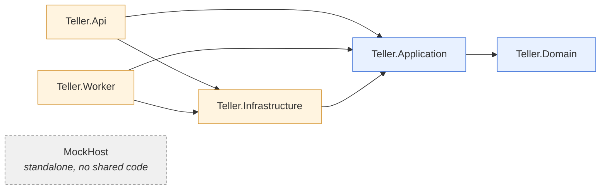
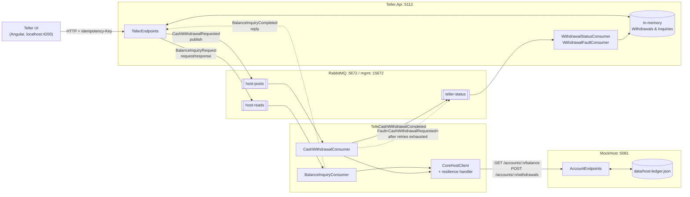
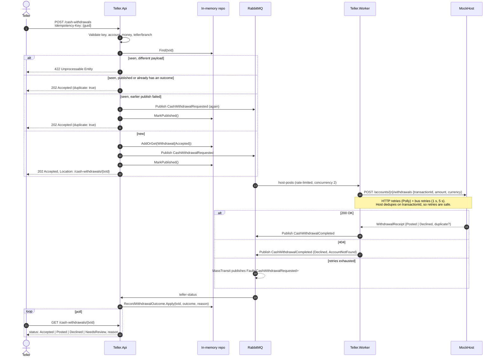
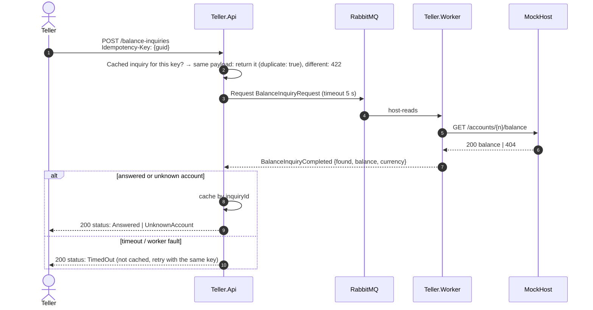
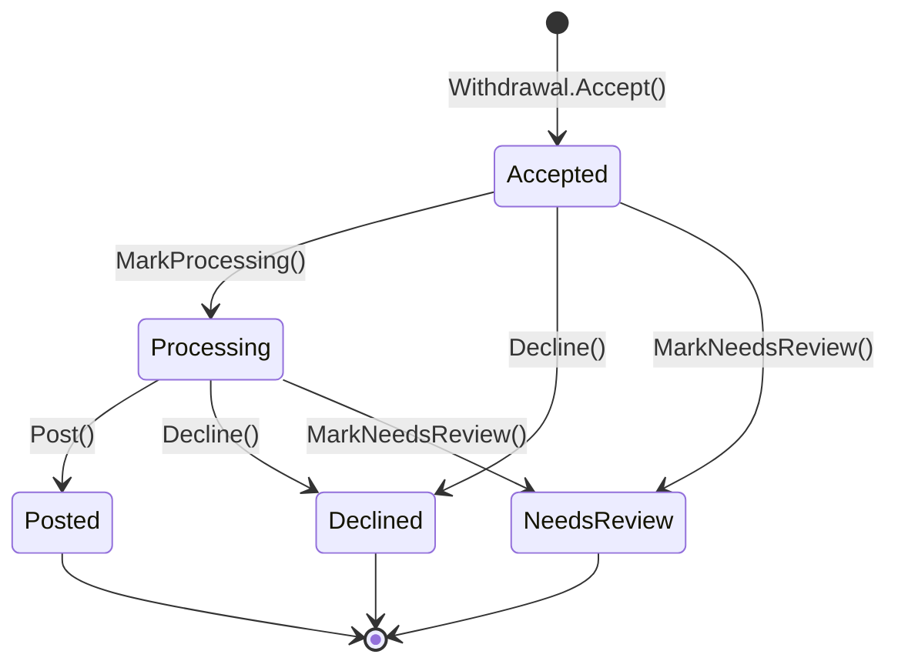
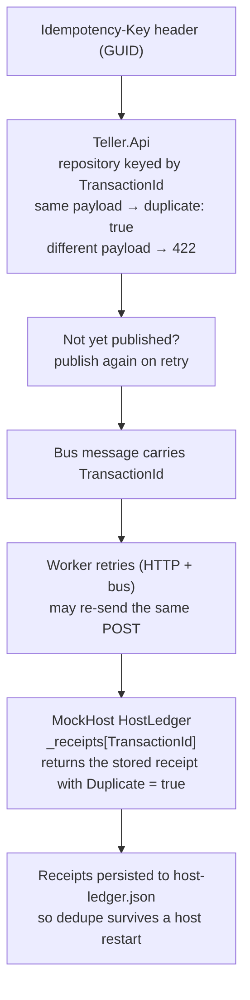
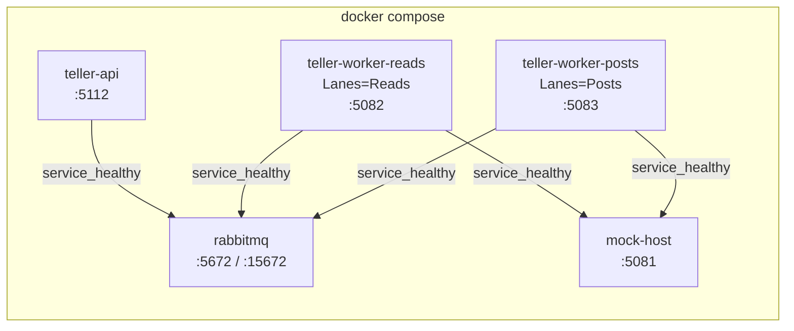
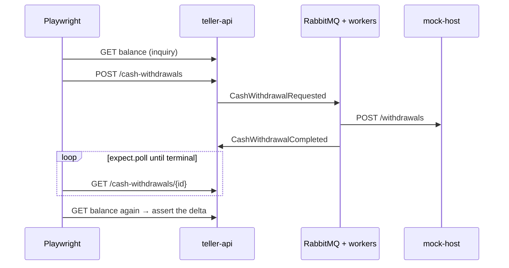
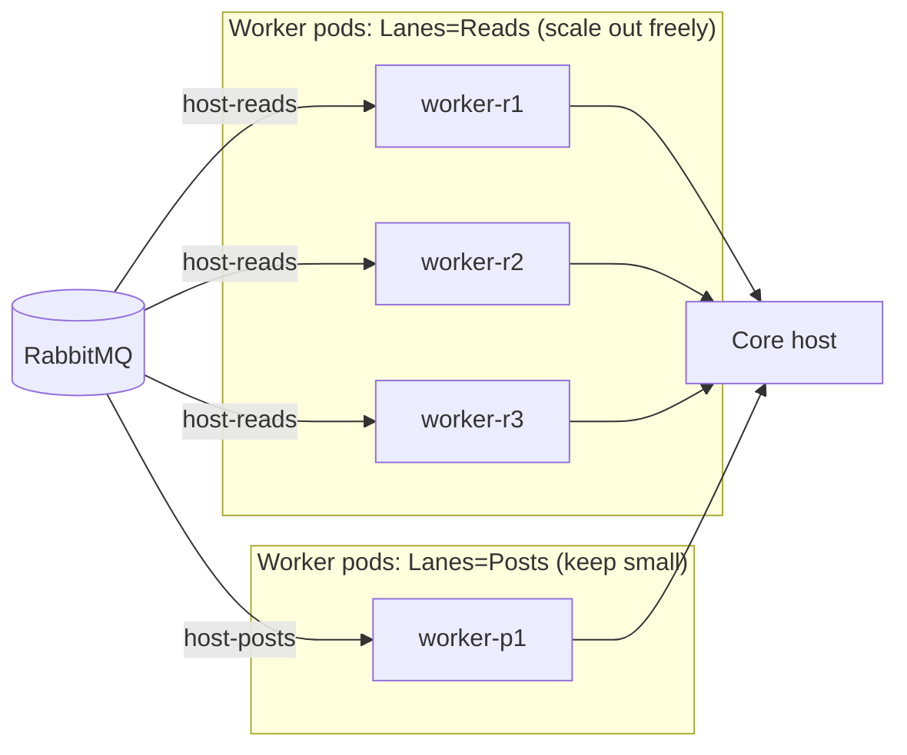

# TellerBus — Architecture & Usage

TellerBus is a .NET 8 sample of a **bank teller front office** that talks to a **core banking host** through a message bus (RabbitMQ + MassTransit). Tellers submit balance inquiries and cash withdrawals over HTTP. A worker moves those requests onto the host at a controlled rate, and results come back as messages.

The design deals with the usual problems of a slow, rate-limited, sometimes-unavailable mainframe-style host:

- **Idempotency end to end.** The client's `Idempotency-Key` becomes the `TransactionId`, and every hop deduplicates on it.
- **Separate read and write lanes.** Reads (balance) and posts (withdrawals) use different queues with their own concurrency and rate limits, and can scale independently.
- **Asynchronous writes.** A withdrawal returns `202 Accepted` right away. The final status is polled later.
- **Unknown outcomes become `NeedsReview`.** A post that keeps failing is never silently dropped.

---

## 1. Solution layout

| Project | Type | Responsibility |
|---|---|---|
| `src/Teller.Domain` | Class library | Value objects (`AccountNumber`, `Money`) and the `Withdrawal` aggregate with its state machine. |
| `src/Teller.Application` | Class library | Use cases (`RequestCashWithdrawal`, `RequestBalanceInquiry`, `GetCashWithdrawal`, `RecordWithdrawalOutcome`), ports (interfaces) and bus message contracts. |
| `src/Teller.Infrastructure` | Class library | *Currently empty.* Placeholder for real adapters. |
| `src/Teller.Api` | ASP.NET Core minimal API | HTTP edge for tellers. Holds in-memory repositories, RabbitMQ adapters and status consumers. |
| `src/Teller.Worker` | ASP.NET Core host + MassTransit | Consumes host-bound messages, calls the core host over HTTP with resilience, and publishes results. |
| `src/MockHost` | ASP.NET Core minimal API | Stand-in for the core banking system. JSON-file ledger, idempotent withdrawals, fault injection. |
| `tests/*` | xUnit | Unit and in-process integration tests for each service. |

### Project dependencies



The Teller side follows **ports and adapters** (hexagonal). `Teller.Application` defines `IWithdrawalRepository`, `IWithdrawalPublisher`, `IBalanceInquiryRepository` and `IBalanceInquiryClient`, and `Teller.Api` supplies the implementations. MockHost deliberately shares no code with the Teller projects, because it stands in for an external system.

---

## 2. Runtime topology



### Queues and messages

| Queue | Consumer (process) | Message | Pattern | Limits (defaults) |
|---|---|---|---|---|
| `host-reads` | `BalanceInquiryConsumer` (Worker) | `BalanceInquiryRequest` → `BalanceInquiryCompleted` | Request/response, 5 s timeout | prefetch 16, concurrency 16 |
| `host-posts` | `CashWithdrawalConsumer` (Worker) | `CashWithdrawalRequested` | Publish/subscribe | prefetch 4, concurrency 2, **10 posts/s**, retry 1 s then 5 s |
| `teller-status` | `WithdrawalStatusConsumer`, `WithdrawalFaultConsumer` (Api) | `CashWithdrawalCompleted`, `Fault<CashWithdrawalRequested>` | Publish/subscribe | MassTransit defaults |

MassTransit creates the exchanges and bindings by message type. No routing keys are configured by hand.

---

## 3. Flows

### 3.1 Cash withdrawal (async, idempotent)



### 3.2 Balance inquiry (sync over async)



### 3.3 Withdrawal state machine (`Teller.Domain.Withdrawal`)



`RecordWithdrawalOutcome` maps bus outcomes to transitions:

| Incoming outcome | Effect | `reason` shown to the teller |
|---|---|---|
| `Posted` | `Accepted → Processing → Posted` in one step | none |
| `Declined` | `Accepted/Processing → Declined` | the host's code: `InsufficientFunds`, `AccountClosed`, `CurrencyMismatch`, or `AccountNotFound` (from the worker on a 404) |
| a `Fault` | `→ NeedsReview` unless already terminal | `HostOutcomeUnknown` |
| anything else | `→ NeedsReview` unless already terminal | `UnrecognizedHostOutcome` |

Terminal states are never overwritten, so a late or duplicate message has no effect. It is still written to the audit trail as `OutcomeIgnored`.

Only business reasons reach the teller. Exception text from a fault goes to the audit trail, because a teller cannot act on it and it can expose internals.

There is one completion message (`CashWithdrawalCompleted`) with an `Outcome` field rather than separate succeeded and failed messages. Both outcomes go to the same consumer and the same state machine, so a second message type would add a binding and a consumer without changing any behaviour. Crashes are already covered by MassTransit's `Fault<CashWithdrawalRequested>`. A separate failure event is worth adding only when another service needs to subscribe to failures alone, for example alerting.

### 3.4 Audit trail

Teller.Api keeps an append-only trail per withdrawal (`IWithdrawalAuditLog`, in memory for now) and serves it at `GET /cash-withdrawals/{id}/audit`.

| Event | Recorded by | Detail |
|---|---|---|
| `Accepted` | `RequestCashWithdrawal` | amount, currency, account, teller, branch |
| `Repeated` | `RequestCashWithdrawal` | same key and payload again, with the status at that moment |
| `KeyReused` | `RequestCashWithdrawal` | the rejected payload (the 422 case) |
| `Published` / `PublishFailed` | `RequestCashWithdrawal` | the broker exception on failure |
| `HostAnswered` | `WithdrawalStatusConsumer` | outcome, reason, available balance, worker attempt number, whether the host replayed an earlier receipt |
| `HostFaulted` | `WithdrawalFaultConsumer` | exception type and message from `Fault<CashWithdrawalRequested>` |
| `Posted` / `Declined` / `NeedsReview` | `RecordWithdrawalOutcome` | the teller-facing reason |
| `OutcomeIgnored` | `RecordWithdrawalOutcome` | an outcome that arrived after the withdrawal was already terminal |

The worker has no store of its own. What it knows about the host call (attempt number, host duplicate flag) travels on `CashWithdrawalCompleted`, and its final failure travels on the `Fault`, so the whole trail can be read in one place.

---

## 4. Idempotency, end to end



The host-side dedupe is what makes the `timeout-after-post` scenario safe. The host posts the debit and then hangs, the worker's 5 s attempt timeout fires, and the retry gets back the original receipt instead of debiting twice.

---

## 5. Resilience settings (Worker → Host)

| Layer | Setting | Value |
|---|---|---|
| `HttpClient` | `Timeout` | Infinite, so it never cuts the pipeline short |
| Standard resilience handler | Retry | 2 attempts, 200 ms base delay |
| | Attempt timeout | 5 s |
| | Total timeout | 20 s, which is the real bound on a call |
| | Circuit breaker sampling | 30 s |
| `CoreHostClient` | Exception mapping | Timeouts (Polly or HTTP) become `CoreHostUnavailableException(504)`, an open circuit becomes `(503)`. Cancellation requested by the caller passes through unchanged. |
| MassTransit (`host-posts` only) | Message retry | 1 s, 5 s, on `CoreHostUnavailableException` or `HttpRequestException` |
| | Rate limit | `Worker:PostsPerSecond` (10/s) |
| | Concurrency limit | `Worker:PostConcurrency` (2) |

---

## 6. How to run

### Prerequisites

- Docker with Compose v2.17 or later (for `--wait`)
- .NET SDK 8.0.100 or later (pinned in `global.json` with `latestFeature` roll-forward), for running services outside Docker and for unit tests
- Node.js 18 or later, for the Playwright e2e tests

### Option A: whole stack in Docker (recommended)

From the repository root:

```bash
docker compose up -d --build --wait
```

`--wait` returns once every container passes its health check. The worker health check (`/health/ready`) includes MassTransit's bus check, so "healthy" means it is connected to RabbitMQ.



| Container | Host port | Health |
|---|---|---|
| `teller-api` | http://localhost:5112 | `/health` |
| `teller-worker-reads` | http://localhost:5082 | `/health/ready` |
| `teller-worker-posts` | http://localhost:5083 | `/health/ready` |
| `mock-host` | http://localhost:5081 | `/health` |
| `rabbitmq` | 5672, UI at http://localhost:15672 (guest / guest) | `rabbitmq-diagnostics ping` |

- The two worker containers share one image (`teller-bus/teller-worker`) and differ only in `Worker__Lanes`.
- MockHost keeps its ledger inside its container. `docker compose down` resets balances to the seed accounts. `stop`/`start` keeps them.
- `MOCK_HOST_TIMEOUT_AFTER_POST_SECONDS` overrides the `timeout-after-post` delay (default 15).
- `.dockerignore` keeps `bin/`, `obj/` and the local `src/MockHost/data/` ledger out of the images.

Stop and reset the stack:

```bash
docker compose down
```

### Option B: services on the host, RabbitMQ in Docker

Use this for debugging in an IDE. Run each command in its own terminal, from the repository root.

```bash
docker compose up -d rabbitmq
```

```bash
dotnet run --project src/MockHost --launch-profile http
```

```bash
dotnet run --project src/Teller.Worker
```

```bash
dotnet run --project src/Teller.Api --launch-profile http
```

> The Api `http` profile and the Worker's default profile set `RabbitMq__Host=localhost`, so they connect to the bus. If Teller.Api starts **without** `RabbitMq:Host`, it runs in an offline mode: withdrawals are only recorded in memory and balance inquiries come back `Pending`.

The ports are the same as Option A, except that a single worker runs all lanes on 5082. Don't run both options at once, because they bind the same ports.

### Unit and integration tests

```bash
dotnet test TellerBus.sln
```

These tests run in-process and need neither Docker nor RabbitMQ.

### End-to-end tests (Playwright)

`tests/e2e` holds a Playwright suite that drives the **running compose stack** over HTTP: Teller.Api → RabbitMQ → Worker → MockHost and back. It uses Playwright's API testing (`request` fixture), so no browsers are installed.

```bash
cd tests/e2e && npm install
```

```bash
cd tests/e2e && npm run stack:up
```

```bash
cd tests/e2e && npm test
```

| Spec | Covers |
|---|---|
| `health.spec.ts` | Every container is up, and both workers are connected to the bus |
| `balance-inquiry.spec.ts` | `Answered`, `UnknownAccount`, cached replay, 422 on key reuse, 400 validation |
| `cash-withdrawal.spec.ts` | `Accepted` → `Posted` with the balance debited, a same-key retry debits once, 422 on key reuse, `Declined` for insufficient funds / closed / unknown account / wrong currency, 400 validation, 404 |
| `host-outage.spec.ts` `@chaos` | Runs `docker compose stop mock-host`, checks the withdrawal ends `NeedsReview` after HTTP and bus retries, then restarts MockHost and checks withdrawals post again |



Notes:

- Tests run with `workers: 1` because they share the seed accounts and assert on balance changes. Assertions are relative (before vs after), so the suite can be re-run without resetting the stack.
- `global-setup.ts` waits up to 60 s for every health endpoint and fails with a hint if the stack isn't running.
- `npm run test:no-chaos` skips the outage test, for environments where the tests can't drive the Docker CLI.
- Point the suite at another deployment with `TELLER_API_URL`, `MOCK_HOST_URL`, `WORKER_READS_URL` and `WORKER_POSTS_URL`.
- After a run, `npm run report` opens the HTML report.

---

## 7. Using the API

### Seed accounts (MockHost `appsettings.json`)

| Account | Balance | Status | Good for testing |
|---|---|---|---|
| `1001001001` | 2500.00 USD | Open | Happy path |
| `1001001002` | 40.00 USD | Open | `InsufficientFunds` |
| `1001001003` | 800.00 USD | Closed | `AccountClosed` |

When MockHost runs on the host, the ledger is persisted to `src/MockHost/data/host-ledger.json` (git-ignored). **Delete that file to reset balances.** In Docker, run `docker compose down` instead.

### Balance inquiry

```bash
curl -s -X POST http://localhost:5112/balance-inquiries -H "Content-Type: application/json" -H "Idempotency-Key: $(uuidgen)" -d '{"accountNumber":"1001001001","tellerId":"T-17","branchId":"BR-001"}'
```

```json
{
  "inquiryId": "…",
  "accountNumber": "1001001001",
  "tellerId": "T-17",
  "branchId": "BR-001",
  "status": "Answered",
  "availableBalance": 2500.00,
  "currency": "USD",
  "duplicate": false,
  "requestedAt": "2026-10-18T14:02:11Z"
}
```

`status` is one of `Answered`, `UnknownAccount`, `TimedOut` or `Pending` (offline mode only).

### Cash withdrawal

```bash
curl -i -X POST http://localhost:5112/cash-withdrawals -H "Content-Type: application/json" -H "Idempotency-Key: 3fa85f64-5717-4562-b3fc-2c963f66afa7" -d '{"accountNumber":"1001001001","amount":100.00,"currency":"USD","tellerId":"T-17","branchId":"BR-001"}'
```

The response is `202 Accepted` with `Location: /cash-withdrawals/{transactionId}` and `status: "Accepted"`.

### Poll the outcome

```bash
curl -s http://localhost:5112/cash-withdrawals/3fa85f64-5717-4562-b3fc-2c963f66afa7
```

`status` is one of `Accepted`, `Processing`, `Posted`, `Declined` or `NeedsReview`. For `Declined` and `NeedsReview`, `reason` says why (see 3.3); otherwise it is `null`.

### Audit trail

```bash
curl -s http://localhost:5112/cash-withdrawals/3fa85f64-5717-4562-b3fc-2c963f66afa7/audit
```

```json
{
  "transactionId": "3fa85f64-5717-4562-b3fc-2c963f66afa7",
  "entries": [
    { "at": "…", "event": "Accepted", "detail": "100.00 USD from 1001001001 by teller T-17 at branch BR-001" },
    { "at": "…", "event": "Published", "detail": null },
    { "at": "…", "event": "HostAnswered", "detail": "Posted, available 2400.00 USD, worker attempt 1." },
    { "at": "…", "event": "Posted", "detail": null }
  ]
}
```

Returns 404 for a transaction that was never submitted.

### Validation rules

| Field | Rule | Error |
|---|---|---|
| `Idempotency-Key` header | Non-empty GUID | 400 |
| `Idempotency-Key` reuse | Must come with the same account, amount, currency, teller and branch (inquiries: account, teller and branch) | 422 |
| `accountNumber` | 6–20 digits | 400 |
| `amount` | > 0, rounded to 2 dp (away from zero) | 400 |
| `currency` | 3 letters, upper-cased | 400 |
| `tellerId`, `branchId` | Non-blank, trimmed | 400 |

### Fault injection (call MockHost directly)

Send the `X-Mock-Fault` header to MockHost:

| Value | Balance endpoint | Withdrawal endpoint |
|---|---|---|
| `unavailable` | 503 | 503 |
| `rate-limited` | 429 | 429 |
| `timeout-after-post` | 400 (withdrawals only) | Posts the debit, then delays `TimeoutAfterPostDelaySeconds` (15 s) |
| anything else | 400 | 400 |

```bash
curl -s -X POST http://localhost:5081/accounts/1001001001/withdrawals -H "Content-Type: application/json" -H "X-Mock-Fault: timeout-after-post" -d '{"transactionId":"11111111-1111-1111-1111-111111111111","amount":10,"currency":"USD"}'
```

> The Worker's `CoreHostClient` never sends `X-Mock-Fault`, so faults currently can only be exercised against MockHost directly or through tests.

---

## 8. Configuration reference

### Teller.Api

| Key | Default | Notes |
|---|---|---|
| `RabbitMq:Host` | *(unset)* | Unset means offline mode (in-memory publisher, no consumers) |
| `RabbitMq:Username` / `Password` | `guest` | |
| CORS | `http://localhost:4200` | Hard-coded policy `angular` |

### Teller.Worker

| Key | Default | Notes |
|---|---|---|
| `RabbitMq:Host` | **required** | Worker refuses to start without it |
| `MockHost:BaseUrl` | `http://localhost:5081` | |
| `Worker:Lanes` | `All` | `All`, `Reads` or `Posts`. Run separate pods per lane to scale independently. |
| `Worker:ReadPrefetch` / `ReadConcurrency` | 16 / 16 | |
| `Worker:PostPrefetch` / `PostConcurrency` | 4 / 2 | |
| `Worker:PostsPerSecond` | 10 | Protects the host |

### MockHost

| Key | Default |
|---|---|
| `MockHost:LedgerPath` | `data/host-ledger.json` (relative to the content root; empty means in-memory only) |
| `MockHost:TimeoutAfterPostDelaySeconds` | 15 |
| `MockHost:Accounts[]` | Seed accounts, used only when the ledger file does not exist |

---

## 9. Scaling with lanes



`PostsPerSecond` applies **per pod**. The effective host write rate is `PostsPerSecond × number of Posts pods`.

---

## 10. Known limitations

Details are in the code review that accompanies this document.

1. **No transactional outbox.** A withdrawal is stored before it is published. If the publish fails, the client gets a 500, and a **retry with the same key publishes it again** (`Withdrawal.Published`). A withdrawal whose client never retries still stays `Accepted`. A durable outbox (for example the MassTransit EF Core outbox) together with a real database would close that gap.
2. **In-memory Teller state.** Restarting Teller.Api loses all withdrawals. With more than one Api instance, `teller-status` outcomes land on a random instance and are dropped if that instance does not hold the withdrawal.
3. **Available balance is not returned to the teller.** The decline reason is, but `CashWithdrawalCompleted.AvailableBalance` only appears in the audit trail.
6. **The audit trail is in memory.** It is lost on restart like the withdrawals, and has no retention limit. It belongs in the same database as the withdrawals once there is one.
4. **No authentication.** `tellerId` and `branchId` are taken from the request body.
5. `Teller.Infrastructure` is an empty project, and `TellerDesk` is unused.
